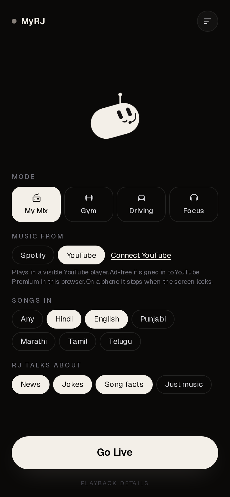
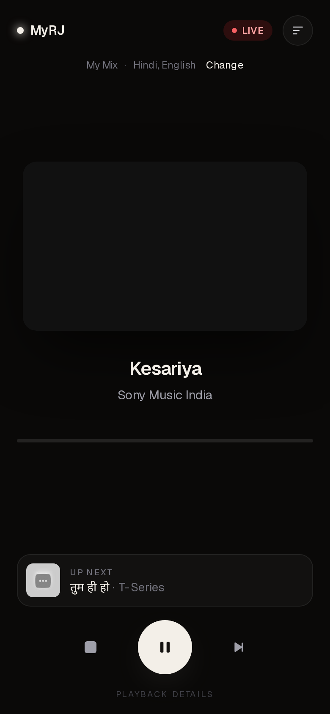
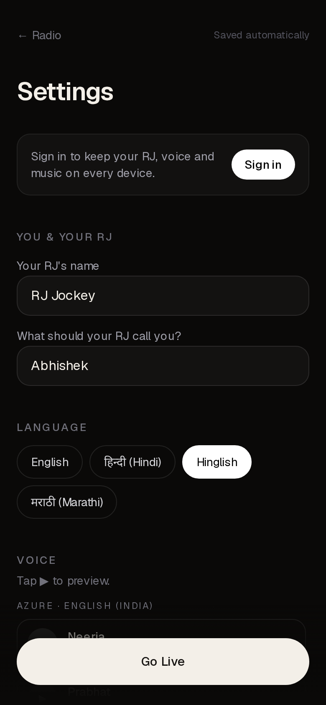
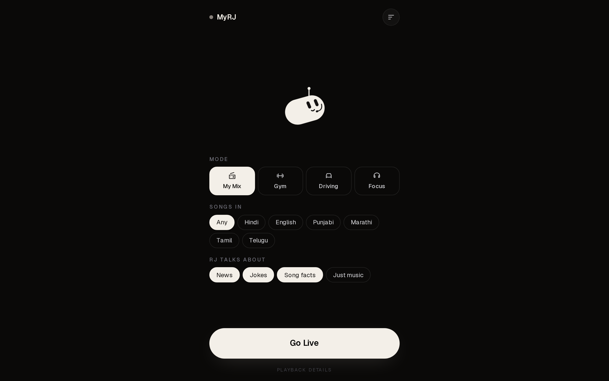

# MyRJ 🎙️ your own AI radio jockey

MyRJ is a personal AI radio station. Pick a mode, tap **Go Live**, and an RJ with a calm, human-ish voice talks between your songs: a quick intro, a joke, a headline or a fun fact about the track. Then the music plays from **Spotify** or **YouTube**. It's built to be **self-hosted**: you run your own copy with your own keys and have fun.

<p align="center">
  
  
  
</p>
<p align="center"></p>

## Features

- **Modes:** My Mix, Gym, Driving and Focus (Focus plays only non-lyrical music).
- **Languages:** the RJ speaks Hindi, English, Hinglish or Marathi. You also choose which languages your *songs* are in, and YouTube picks are strictly filtered to them.
- **Music sources:** Spotify (Web Playback SDK on desktop, Spotify Connect on phones) and YouTube (embedded player, ad-free with YouTube Premium).
- **Talks about what you want:** toggle news, jokes and song facts per session, or go "just music".
- **Voice:** Azure Speech (free tier friendly), optional ElevenLabs, browser speech as a fallback. Soft background intro/outro music and music ducking while the RJ talks.
- **Mascot:** a small animated pill-shaped robot that glances at you, reacts to taps and "speaks" along with the RJ.
- **Synced lyrics** display, lock-screen / headphone controls (MediaSession), and a single playback state machine so play/pause is dependable.
- **Your taste:** seeds from your Spotify and YouTube likes and playlists, or import links and screenshots (read with Claude).
- **Accounts are optional:** with Supabase you get Google / magic-link sign-in and sync across devices. Without it, everything stays in your browser.

## Quickstart (about 10 minutes)

You need Node 20+ and at least one voice or music key (see [setup guides](#setup-guides)).

```bash
git clone https://github.com/lonkarabhishek/ai-rj.git
cd ai-rj
npm install
cp .env.example .env.local   # fill in the keys you have
npm run dev -- -H 127.0.0.1
```

Open http://127.0.0.1:3000 (use `127.0.0.1`, not `localhost`, because Spotify login needs it).

Minimum useful setup: `ANTHROPIC_API_KEY` + `AZURE_SPEECH_KEY` + either Spotify or Google/YouTube keys. With no keys at all the app still opens and uses template lines plus browser speech, but you'll have no music.

### Deploy to Vercel

[](https://vercel.com/new/clone?repository-url=https%3A%2F%2Fgithub.com%2Flonkarabhishek%2Fai-rj&env=ANTHROPIC_API_KEY,AZURE_SPEECH_KEY,AZURE_SPEECH_REGION,SPOTIFY_CLIENT_ID,SPOTIFY_CLIENT_SECRET,SPOTIFY_REDIRECT_URI,GOOGLE_CLIENT_ID,GOOGLE_CLIENT_SECRET,NEXT_PUBLIC_SUPABASE_URL,NEXT_PUBLIC_SUPABASE_ANON_KEY,SUPABASE_SERVICE_ROLE_KEY,TOKEN_ENCRYPTION_KEY&envDescription=Fill%20in%20what%20you%20need%2C%20leave%20the%20rest%20blank.%20See%20.env.example&envLink=https%3A%2F%2Fgithub.com%2Flonkarabhishek%2Fai-rj%2Fblob%2Fmain%2F.env.example&project-name=myrj&repository-name=myrj)

Vercel will ask for each variable; blank is fine for services you skip. After deploying, set `SPOTIFY_REDIRECT_URI` to `https://YOUR-APP.vercel.app/api/auth/callback/spotify` and add the same URLs in the Spotify, Google and Supabase dashboards (below), then redeploy.

## Setup guides

All variables are listed with comments in [`.env.example`](.env.example).

| Service | Needed for | Required? |
| --- | --- | --- |
| Anthropic (Claude) | RJ scripts, language labels, import | Recommended (templates otherwise) |
| Azure Speech | RJ voice | Recommended (browser voice otherwise) |
| Spotify | Spotify playback | One music source needed |
| Google / YouTube | YouTube playback | One music source needed |
| Supabase | Accounts and sync | Optional |

### Anthropic
1. Create a key at https://console.anthropic.com.
2. Set `ANTHROPIC_API_KEY`. The default model is a small Claude Haiku model; override with `ANTHROPIC_MODEL`.

### Azure Speech (voice)
1. In the Azure Portal create a **Speech service** (the free F0 tier gives roughly 500k characters a month at the time of writing; check current pricing).
2. Copy **Key 1** and the **region** to `AZURE_SPEECH_KEY` and `AZURE_SPEECH_REGION`.
3. Optional: set `ELEVENLABS_API_KEY` to use ElevenLabs voices instead.

### Spotify
1. https://developer.spotify.com/dashboard → **Create app**. Tick *Web API* and *Web Playback SDK*.
2. Add Redirect URIs: `http://127.0.0.1:3000/api/auth/callback/spotify` and your deployed URL.
3. Copy the Client ID and Secret to `SPOTIFY_CLIENT_ID` / `SPOTIFY_CLIENT_SECRET`, and set `SPOTIFY_REDIRECT_URI`.
4. Add your own Spotify account under **Users and Access**.

> **Heads-up on Spotify's limits:** new apps run in *development mode*: at most **5 allow-listed users**, a request quota shared across all your apps, and playback needs **Premium**. If you hit a `429` with `QUOTA_EXCEEDED`, wait for the daily reset. This is exactly why MyRJ is meant to be **self-hosted for you and a few friends**, not run as one public service.

### Google / YouTube
1. https://console.cloud.google.com → new project → enable **YouTube Data API v3**.
2. **OAuth consent screen** → External. Scopes: `openid`, `email`, `profile`, `.../auth/youtube.readonly`. While the app is in *Testing*, **add yourself (and friends) as Test users**, otherwise Google blocks sign-in.
3. **Credentials → OAuth client ID → Web application.**
   - Origins: `http://127.0.0.1:3000` and your deployed URL.
   - Redirect URIs: `http://127.0.0.1:3000/api/auth/callback/youtube`, `https://YOUR-APP.vercel.app/api/auth/callback/youtube`, and, if you use Supabase Google sign-in, `https://YOUR-PROJECT.supabase.co/auth/v1/callback`.
4. Set `GOOGLE_CLIENT_ID` and `GOOGLE_CLIENT_SECRET`.

> **YouTube quota:** the Data API gives **10,000 units a day** per project. A search costs 100 units, list calls cost 1. That's plenty for personal use and limits how many fresh sessions a day a shared deployment can serve. The video player must stay visible (YouTube's rule), and on phones playback stops when the screen locks. Sign in to YouTube Premium in the same browser for no ads.

### Supabase (optional)
1. Create a project at https://supabase.com.
2. Run the migration in [`supabase/migrations/20261014000000_accounts.sql`](supabase/migrations/20261014000000_accounts.sql) (SQL Editor, or `supabase db push`). It creates `profiles`, `taste_seeds` and `provider_tokens` with row level security. `provider_tokens` is server-only.
3. Set `NEXT_PUBLIC_SUPABASE_URL`, `NEXT_PUBLIC_SUPABASE_ANON_KEY` (publishable key), `SUPABASE_SERVICE_ROLE_KEY` (secret key, server only) and `TOKEN_ENCRYPTION_KEY` (`openssl rand -base64 32`, set once, never change).
4. Authentication → Providers → **Google**: paste your Google client ID and secret.
5. Authentication → URL Configuration: set **Site URL** to your deployed URL and add `…/auth/callback` (and `http://127.0.0.1:3000/auth/callback`) to Redirect URLs.
6. Magic-link emails use Supabase's built-in mailer, which is heavily rate limited. Add custom SMTP before inviting people.

## Cost notes

Designed to be free-tier friendly for one person: Vercel Hobby, Supabase free, Azure Speech free tier, and a small Claude Haiku model where one RJ line costs a fraction of a cent. Spotify and YouTube APIs are free but rate limited as described above. Check each provider's current pricing, since it changes.

## Testing

```bash
npm run build
npm run e2e        # builds, then runs Playwright against fake Spotify/YouTube/voice
```

First time: `npx playwright install chromium`. `npm run e2e:prod` runs a few checks against a deployed copy: `PROD_URL=https://your-app.vercel.app npm run e2e:prod`.

## Troubleshooting

- **RJ is silent / voice fails on iPhone:** iOS only allows audio after a tap. Use the **Go Live** button (it unlocks audio), don't reload mid-session, and make sure the phone isn't on silent mode.
- **Spotify says "not connected" or loops on 429:** open **Playback details** at the bottom of the live screen. `QUOTA_EXCEEDED` means Spotify's daily quota is used up; wait and retry. A 403 means your account isn't in **Users and Access**.
- **Spotify login redirect fails:** the redirect URI must match exactly and use `127.0.0.1` locally.
- **Google says "access blocked":** add your account as a **Test user** on the OAuth consent screen.
- **YouTube video won't play:** some uploads aren't embeddable; MyRJ skips them. Keep the player visible and on screen.
- **Mascot doesn't move with the voice:** voice-synced motion works on desktop Chrome/Edge; other browsers use a rhythm animation.
- **Anything else:** open **Playback details** and attach a screenshot to your issue.

## Contributing

Issues and PRs are welcome. See [CONTRIBUTING.md](CONTRIBUTING.md). Security reports: [SECURITY.md](SECURITY.md).

## Roadmap

- [ ] Apple Music source (MusicKit)
- [ ] More RJ voices and personalities
- [ ] More languages
- [ ] Installable PWA polish
- [ ] "Voice only" companion mode over your own music app
- [ ] Better offline / fallback behaviour

## License

[MIT](LICENSE). MyRJ doesn't host or redistribute any music. Playback goes through Spotify's and YouTube's official players under their terms; you're responsible for following those terms with your own accounts.
